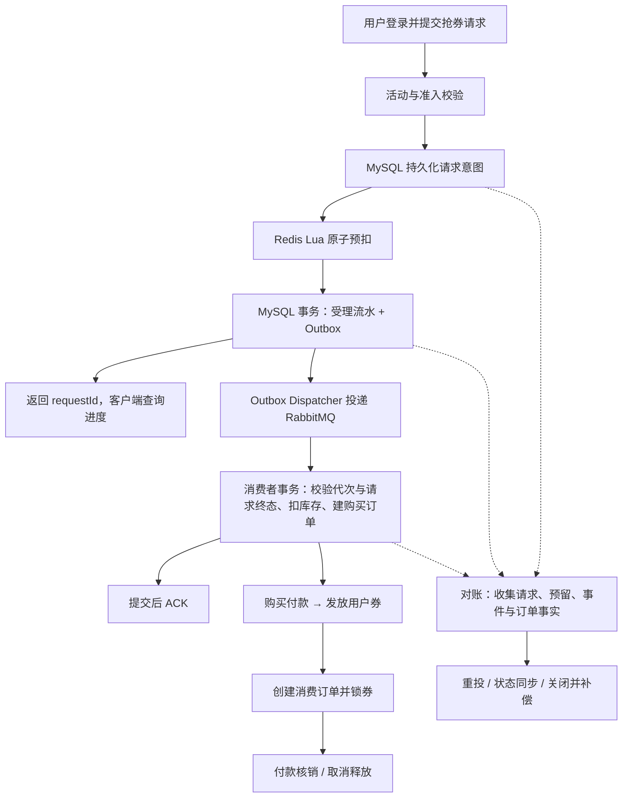

# VoucherX

**面向高并发场景的优惠券与营销权益平台。**

VoucherX 基于 Java 21 和 Spring Boot，覆盖抢券、异步建单、付款发券、消费核销与对账补偿。项目采用模块化单体架构，以 Redis、RabbitMQ 和 MySQL 之间的状态协作为主线，实践并发控制、可靠消息与事务一致性。

适合学习 Java 后端交易链路与分布式一致性机制。当前提供本地演示环境和模拟支付，不对接真实短信及支付渠道。

[快速开始](#快速开始) · [接口概览](#接口概览) · [测试](#测试) · [源码导航](#源码导航) · [开发与维护](#开发与维护)

## 核心能力

- **并发抢券与库存分桶**：Redis Lua 原子完成库存预扣与资格占用，MySQL 条件扣减和唯一约束保障最终库存及购买资格。支持单库存与数据库库存桶，采用稳定路由和有界跨桶尝试；默认使用 `SINGLE`，`BUCKET` 作为实验能力显式配置。
- **可靠异步下单**：持久化请求意图，以同一事务记录受理流水和 Transactional Outbox；通过扫描重投、Publisher Confirm、路由校验、消费幂等和提交后 ACK 推进建单。支持默认关闭的有界批量处理与失败拆分。
- **订单与核销闭环**：区分购买订单、用户券、消费订单和核销流水。购买订单保存交易权益快照，付款后发券；消费下单锁定用户券，付款核销，取消或超时关闭时按归属释放。
- **对账与幂等补偿**：关联请求、预留、事件和订单，按数据库终态决定重投、同步或补偿。先关闭数据库请求，再原子返还 Redis 预留，结合补偿标识与修复审计支持重复执行和中断续作。

此外，项目包含验证码登录、商户 Cache Aside 缓存、多级限流与 AIMD 自适应准入、活动冻结与恢复代次屏障。限流与自适应默认关闭；故障注入仅在显式启用时生效。

## 业务流程



Redis 预扣与 MySQL 受理之间通过持久化意图和对账衔接。`PROCESSING` 表示受理与 Outbox 已提交；查询返回 `SUCCESS` 表示购买订单已创建，付款、发券和核销是后续步骤。

## 技术栈

| 领域 | 技术 |
| --- | --- |
| 应用 | Java 21、Spring Boot 3.3.5、Maven |
| 持久化 | MySQL 8、MyBatis-Plus 3.5.9、MyBatis XML |
| 缓存与原子操作 | Redis 7、Lua |
| 消息 | RabbitMQ 3.13、Spring AMQP |
| 测试 | JUnit 5、Testcontainers、Awaitility |
| 本地环境 | Docker Compose |

## 快速开始

需要 JDK 21、Maven 3.6.3+、Docker 和 Docker Compose v2。以下命令在 Bash / Zsh 下执行。

### 1. 获取代码并启动依赖

```bash
git clone https://github.com/fishandrice000000/VoucherX.git
cd VoucherX
cp .env.example .env

set -a
source .env
set +a

docker compose up -d --wait
```

默认本地连接配置如下，完整示例见 [.env.example](.env.example)。

| 服务 | 地址 | 本地演示账号 |
| --- | --- | --- |
| MySQL | `localhost:3307`，数据库 `voucherx` | `voucherx / voucherx` |
| Redis | `localhost:6380` | 无密码 |
| RabbitMQ AMQP | `localhost:5673` | `voucherx / voucherx` |
| RabbitMQ 管理台 | `http://localhost:15673` | `voucherx / voucherx` |

首次创建 MySQL 数据卷时自动执行 [schema.sql](src/main/resources/db/schema.sql) 和 [seed.sql](src/main/resources/db/seed.sql)，生成商户 `1` 与库存为 `100` 的演示秒杀活动 `1`。活动库存与门禁由应用启动时初始化。

数据库使用全新建库脚本；已有数据卷不会随重启更新表结构。需要独立演示环境时，请使用新的数据库与配套 Redis、消息状态。

### 2. 启动应用

在加载上述环境变量的终端执行：

```bash
mvn spring-boot:run
```

应用地址为 `http://localhost:8080`。也可打包运行：

```bash
mvn -DskipTests package
java -jar target/voucherx-0.1.0-SNAPSHOT.jar
```

`.env.example` 设置了 `AUTH_EXPOSE_CODE=true`，用于在本地响应中获取模拟验证码。部署环境应关闭验证码回显，并配置独立凭据。

### 3. 走通抢券流程

```bash
# 查询演示商户
curl http://localhost:8080/api/shops/1

# 申请验证码，从响应 data.code 取值
curl -X POST http://localhost:8080/api/auth/code \
  -H 'Content-Type: application/json' \
  -d '{"phone":"13900000001"}'

# 替换 <code>，从响应 data.token 取得登录 Token
curl -X POST http://localhost:8080/api/auth/login \
  -H 'Content-Type: application/json' \
  -d '{"phone":"13900000001","code":"<code>"}'

# 替换 <token>，保存响应 data.requestId
curl -i -X POST http://localhost:8080/api/seckill/vouchers/1 \
  -H 'Authorization: Bearer <token>' \
  -H 'Idempotency-Key: demo-purchase-1'

# 查询建单结果；SUCCESS 时 data.orderId 是购买订单 ID
curl 'http://localhost:8080/api/seckill/requests/<requestId>' \
  -H 'Authorization: Bearer <token>'
```

同一次抢券重试需复用 `Idempotency-Key`，取值为 1–64 位字母、数字或 `._:-`。异步结果包括 `UNKNOWN`、`PROCESSING`、`SUCCESS` 和 `FAILED`；`UNKNOWN` 表示中间结果待核对，可继续查询。

### 4. 体验付款与核销

启动应用前执行 `export PAYMENT_SIMULATION_ENABLED=true` 即可启用模拟支付。演示券售价为 `1000` 分，面值为 `10000` 分；所有金额均使用整数分。

```bash
# 替换 <purchaseOrderId> 与 <token>，购买付款后生成用户券
curl -X POST http://localhost:8080/api/payments/simulate \
  -H 'Authorization: Bearer <token>' \
  -H 'Content-Type: application/json' \
  -d '{"orderKind":"PURCHASE","orderId":<purchaseOrderId>,"eventId":"demo-pay-1","amount":1000,"success":true}'

# 查询本人用户券，取列表中用户券的 id
curl 'http://localhost:8080/api/coupons?after=0&size=20' \
  -H 'Authorization: Bearer <token>'

# 替换 <couponId>；创建消费订单并锁券
curl -X POST http://localhost:8080/api/consumption-orders \
  -H 'Authorization: Bearer <token>' \
  -H 'Content-Type: application/json' \
  -d '{"shopId":1,"couponId":<couponId>,"originalAmount":15000}'
```

查询 `GET /api/orders/CONSUMPTION/<orderId>` 可查看服务端计算的 `pay_amount`。随后向模拟支付接口提交 `orderKind=CONSUMPTION`、该订单 ID、独立 `eventId` 和应付金额即可核销；同一支付事件重试应复用其 `eventId` 与原始参数。

## 接口概览

受保护接口统一使用 `Authorization: Bearer <token>`。响应结构为 `{"code":0,"message":"OK","data":...}`；业务错误同时提供 HTTP 状态码和业务错误码。

| 方法 | 路径 | 说明 |
| --- | --- | --- |
| `POST` | `/api/auth/code` | 申请验证码，公开接口 |
| `POST` | `/api/auth/login` | 验证码登录，公开接口 |
| `GET` | `/api/auth/me` | 当前用户 |
| `POST` | `/api/auth/logout` | 退出登录 |
| `GET` | `/api/shops/{shopId}` | 商户查询，公开接口 |
| `POST` | `/api/seckill/vouchers/{voucherId}` | 提交抢券，必填幂等键，返回 HTTP 202 |
| `GET` | `/api/seckill/requests/{requestId}` | 本人抢券请求进度 |
| `GET` | `/api/orders/{kind}/{id}` | 本人订单，类型为 `PURCHASE` / `CONSUMPTION` |
| `POST` | `/api/orders/{kind}/{id}/cancel` | 取消待付款订单 |
| `GET` | `/api/coupons` | 本人用户券，`after` / `size` 游标分页 |
| `POST` | `/api/consumption-orders` | 使用用户券创建消费订单 |
| `POST` | `/api/payments/simulate` | 模拟付款，需显式启用 |

## 配置

应用配置见 [application.yml](src/main/resources/application.yml)。常用开关：

| 环境变量 | 默认值 | 用途 |
| --- | --- | --- |
| `AUTH_EXPOSE_CODE` | `false` | 验证码回显；配置示例在本地启用 |
| `DELIVERY_ENABLED` | `true` | Outbox 后台投递 |
| `DELIVERY_BATCH_ENABLED` | `false` | 有界批量消费 |
| `PAYMENT_SIMULATION_ENABLED` | `false` | 模拟支付接口 |
| `RECONCILE_ENABLED` | `false` | 自动对账与修复扫描 |
| `ADMISSION_MODE` | `OFF` | 准入模式：`OFF` / `FIXED` / `ADAPTIVE` |
| `FAULT_INJECTION_ENABLED` | `false` | 故障注入 |

## 测试

```bash
# 不依赖外部组件的单元测试
mvn -Punit test

# 真实 MySQL / Redis / RabbitMQ 组件测试，需要 Docker
mvn -Pintegration -Dtest=DeliveryComponentTest test

# 全部测试，包含并发争抢与故障相关用例，需要 Docker
mvn test
```

Testcontainers 为集成测试创建独立组件。测试覆盖请求幂等、可靠投递、交易核销、补偿和恢复等路径。压测工具与实验方法见 [bench/README.md](bench/README.md)；本 README 不提供当前版本的性能承诺，库存桶与自适应策略的收益需要在目标环境验证。

## 源码导航

| 路径 | 职责 |
| --- | --- |
| [auth](src/main/java/com/voucherx/auth) / [shop](src/main/java/com/voucherx/shop) | 登录认证与商户缓存 |
| [voucher](src/main/java/com/voucherx/voucher) / [seckill](src/main/java/com/voucherx/seckill) | 券与秒杀配置、入口校验、库存预扣、结果查询 |
| [fulfillment](src/main/java/com/voucherx/fulfillment) / [mq](src/main/java/com/voucherx/mq) | 持久受理、Outbox 投递与消息消费 |
| [order](src/main/java/com/voucherx/order) / [commerce](src/main/java/com/voucherx/commerce) | 购买建单、付款发券、消费锁券与核销 |
| [reconcile](src/main/java/com/voucherx/reconcile) | 请求诊断、重投、补偿与审计 |
| [admission](src/main/java/com/voucherx/admission) / [recovery](src/main/java/com/voucherx/recovery) | 准入控制、活动冻结与状态重建 |
| [db](src/main/resources/db) / [mapper](src/main/resources/mapper) / [lua](src/main/resources/lua) | 建库、业务 SQL、Redis 原子脚本 |
| [tests](src/test/java/com/voucherx) | 单元测试与组件集成测试 |
| [scripts](scripts/README.md) / [bench](bench/README.md) | 格式化、维护与性能实验工具 |

## 开发与维护

生产 MySQL 数据访问统一通过 MyBatis / MyBatis-Plus Mapper，事务边界保留在服务层。修改持久化逻辑时，应保留加锁顺序、条件更新、幂等与恢复代次校验。

Java 格式化使用共享的 [Eclipse Formatter 配置](java-formatter.xml)：

```bash
python3 scripts/format-java.py path/to/ChangedFile.java
python3 scripts/format-java.py --check path/to/ChangedFile.java
```

脚本调用已安装的 VS Code Red Hat Java 扩展内置 Formatter。编辑器设置 `java.format.settings.url=java-formatter.xml`、`java.format.settings.profile=VoucherX` 即可使用同一规则。

本地维护入口提供请求诊断、修复、补偿及活动冻结恢复，使用方法见 [scripts/README.md](scripts/README.md)。提交使用 Conventional Commits，英文 Type / Scope 配合中文描述；提交前运行相关测试并检查差异。
